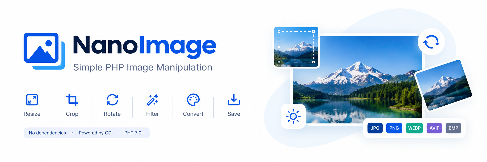

# NanoImage

<p align="center">
  
</p>

<p align="center">
  <strong>A lightweight PHP library for everyday image manipulation.</strong>
  <br>
  Resize, crop, rotate, filter, convert, and save images with a simple, dependency-free API powered by PHP's GD extension.
</p>

<p align="center">
  
  
  
  
</p>

## Overview

NanoImage is a lightweight PHP image library built on the GD extension. It provides common image operations, including resizing, cropping, rotating, applying filters, and converting between supported formats.

Images can be displayed directly, returned as binary data, or saved to a file. NanoImage also handles transparency, supports safe file saving, and checks which image formats are available in the current GD installation.

### Features

| Feature | Description |
|---|---|
| Resize and Scale | Resize images with optional aspect ratio preservation. |
| Crop | Crop an image to a specified area. |
| Rotate and Flip | Rotate images and flip them horizontally or vertically. |
| Filters and Blur | Apply image filters and blur effects. |
| Format Conversion | Convert images to supported output formats. |
| Flexible Output | Display images, return binary data, or save them to a file. |
| Transparency | Preserve transparency in supported formats or flatten transparent areas when needed. |
| Safe File Saving | Write to a temporary file before replacing the destination, helping prevent partial files and preserve existing files when saving fails. |
| Format Support Checks | Check which image formats the current GD installation can read or write. |


### Requirements

Requires PHP and the GD extension. Support for individual image formats depends on the installed PHP and GD build.

| Requirement | Purpose |
|---|---|
| PHP `8.0` or later | Required PHP version. |
| GD extension (`ext-gd`) | Required for image processing. |
| GD format support | WebP, AVIF, and other format support depends on the installed GD build. |
| EXIF extension (`ext-exif`) | Required only for read/write EXIF metadata |


### Supported Image Formats

| Format | Extension | Transparency |
|---|---|---|
| JPEG | `.jpg`, `.jpeg` | Flattened onto white |
| PNG | `.png` | Preserved |
| GIF | `.gif` | Supported, subject to GD limitations |
| WebP | `.webp` | Preserved when supported |
| BMP | `.bmp` | Flattened onto white |
| AVIF | `.avif` | Preserved when supported |

See [Supported Formats](#supported-formats) for format detection and runtime availability details.


---

## Installation

```bash
composer require peterujah/nano-image
```

## Quick start

```php
use Peterujah\Media\NanoImage;
use Peterujah\Media\Exceptions\UnsupportedImageException;

try {
    $image = new NanoImage('path/to/photo.jpg');   
    // or: (new NanoImage())->open('path/to/photo.jpg')

    // Fit inside 360x200 keeping the aspect ratio, save as photo-360x200.jpg
    $image->resize(360, 200, true);
    $image->save('path/to/out/photo.jpg', NanoImage::THUMBNAIL, 80);

    // The instance is still usable: make another size and a WebP copy
    $image->resize(116, 80);
    $image->saveAs('path/to/out/photo.jpg', NanoImage::THUMBNAIL, 90, NanoImage::WEBP);

    $image->free();
} catch (UnsupportedImageException $e) {
    echo $e->getMessage();   // the file is missing, corrupt, unsupported, or GD is not installed
}
```

---

## Loading

```php
$image = new NanoImage('photo.jpg');           // a file path (the class checks it is a real image)
$image = new NanoImage($binaryImageData);      // raw image data also works
$image = new NanoImage();                      // nothing loaded yet

$image->open('photo.jpg');                     // from a file or URL readable by getimagesize()
$image->load(file_get_contents('photo.png'));  // from a string

$image->getWidth();      // int, pixels of the image as currently held
$image->getHeight();     // int
$image->getMimeType();   // e.g. "image/jpeg"
$image->getExifData();   // e.g. "image/jpeg"
```

Loading a new image replaces (and frees) the previous one. Images that would not fit in PHP's `memory_limit` are rejected up front with an `UnsupportedImageException` instead of crashing PHP.

## Resizing

```php
$image->resize(200, 200);          // exactly 200x200 (may distort)
$image->resize(200, 200, true);    // fit inside a 200x200 box, keep proportions (e.g. 200x133)
$image->scale(0.5);                // half the size, keeping proportions
$image->setWidth(640)->setHeight(480)->aspectRatio(true);   // the same idea, step by step
```

* Sizes must be greater than 0; enlarging is allowed.
* With the ratio option the output is *fitted inside* the box, so one side can be smaller than requested.
* The `THUMBNAIL` file name uses the box you passed to `resize()` (`photo-200x200.jpg`), even when the ratio option made the actual image smaller.

## Cropping, rotating and flipping

```php
$image->crop(10, 20, 300, 200);                 // x, y, width, height; throws if outside the image
$image->rotate(90);                             // counter-clockwise (GD convention); -90 is clockwise
$image->rotate(30, '#ffffff');                  // corners filled white ("#rgb", "#rrggbb", "#" optional)
$image->flip();                                 // NanoImage::FLIP_HORIZONTAL (default)
$image->flip(NanoImage::FLIP_VERTICAL);         // or FLIP_BOTH
```

Rotating by a multiple of 90 degrees keeps every pixel. Other angles enlarge the canvas; with no background colour the corners are transparent (and saved white for JPEG/BMP).

---

## Filters and blur

```php
$image->grayscale();
$image->brightness(30);        // -255..255
$image->contrast(20);          // -100..100, positive = more contrast
$image->blur(5);               // immediate; see the note below

// Any GD filter, queued until the image is written
$image->filter(IMG_FILTER_COLORIZE, 100, 50, 0);
$image->filters([
    [IMG_FILTER_CONTRAST, -50],        // GD's own contrast sign: negative = MORE contrast
    [IMG_FILTER_GAUSSIAN_BLUR],
]);
```

If GD rejects a queued filter (an unknown constant or missing arguments), the save fails and returns `false`; nothing is written.

> `contrast()` flips GD's inverted sign for you. The raw `filter(IMG_FILTER_CONTRAST, ...)` does not.
> `blur($range, $argument)`: `$range` is the number of blur passes; `$argument` is kept only for backward compatibility and has no effect, because GD's Gaussian blur takes no strength value.
> Blurred images come out slightly brighter (the original smoothing step adds brightness).

---

## Output

```php
// 1. Send to the browser (sets the Content-Type header, nothing is sent if encoding fails)
$image->display(90);

// 2. Get the encoded bytes
$bytes = $image->toString(90);      // '' on failure
file_put_contents('copy.jpg', $bytes);

// 3. Write the bytes to the current output without a header
$image->get(90);

// 4. Save to disk
$image->save('out/photo.jpg', NanoImage::DEFAULT, 90);
echo $image->getSavedPath();        // the file that was actually written
```

The output format follows the **extension you save to** (`save()`) or the **extension you pass** (`saveAs()`). `toString()`, `get()` and `display()` use the source image's format.

---

### Save options

| `$mode` | Behaviour |
|---|---|
| `NanoImage::DEFAULT` | Use the name as given; an existing file is replaced, but only after the new file is complete. |
| `NanoImage::THUMBNAIL` | Append the size: `photo.jpg` -> `photo-360x200.jpg`. |
| `NanoImage::TIMESTAMP` | Append the date and time: `photo-13-10-26-22-46-00.jpg` (a counter is added if the name exists). |

```php
$image->save('out/photo.jpg', NanoImage::TIMESTAMP, 85);
$image->saveAs('out/photo.png', NanoImage::DEFAULT, 90, NanoImage::WEBP);   // writes out/photo.webp
$image->replace('out/photo.jpg', 90);       // overwrite that file
$image->removeExif('out/clean.jpg');        // see the metadata note below
$image->remove();                           // delete the file the image was OPENED from (not the saves)
$image->free();                             // release memory and reset the instance
```

* `save()` and `saveAs()` create missing directories.
* A path with no extension keeps the source format and gets its extension appended.
* An unsupported extension (or a format your GD cannot write) makes the method return `false`.
* `quality` is 0-100. JPEG/WebP/AVIF use it as lossy quality; PNG maps it to the compression level (still lossless); GIF and BMP ignore it. `save()` defaults to 100, `saveAs()` and `replace()` to 90.

---

## Supported formats

| Format | Read | Write | Transparency kept |
|---|---|---|---|
| JPEG (`jpg`, `jpeg`) | yes | yes | no, flattened on white |
| PNG | yes | yes | yes |
| GIF | yes | yes | on/off only |
| WebP | if GD has WebP | if GD has WebP | yes |
| AVIF | if GD has AVIF (PHP 8.1+) | if GD has AVIF | yes |
| BMP | yes | yes | no, flattened on white |

Check what your server supports with `print_r(gd_info());`. A format GD cannot decode throws `UnsupportedImageException` when loading; one it cannot encode makes the save return `false`.

---

## Metadata (EXIF)

GD never copies metadata into the images it writes, so every saved image is already stripped; `removeExif()` is simply a clearly named shortcut for `save($path, NanoImage::DEFAULT, 100)`.

`addExif()` and `setExif()` need an `exif_write_data()` function, which **standard PHP does not provide**. Without one they return `false` and save nothing.

---

## Method reference

| Method | Returns | Notes |
|---|---|---|
| `__construct($source = null)` | | file path or raw image data |
| `open(string $file)` | `self` | throws `UnsupportedImageException` |
| `load(string $data)` | `self` | throws `UnsupportedImageException` |
| `getWidth()`, `getHeight()` | `int` | current size in pixels |
| `getMimeType()` | `string` | MIME type of the source |
| `getExifData()` | `array` | Read Image exift data |
| `getExtension()` | `string` | extension used by the last save |
| `getSavedPath()` | `string` | file written by the last successful save |
| `isResized()` | `bool` | whether `resize()` was called |
| `setWidth(int)`, `setHeight(int)`, `aspectRatio(bool)` | `self` | queued |
| `resize(int $w, int $h, bool $ratio = false)` | `self` | queued |
| `scale(float $factor)` | `self` | immediate |
| `crop(int $x, int $y, int $w, int $h)` | `self` | immediate |
| `rotate(float $degrees, $background = null)` | `self` | immediate |
| `flip(int $mode = FLIP_HORIZONTAL)` | `self` | immediate |
| `grayscale()`, `brightness(int)`, `contrast(int)` | `self` | queued |
| `filter(int $filter, ...$args)`, `filters(array)` | `self` | queued |
| `blur(int $range = 5)` | `self` | immediate |
| `save()`, `saveAs()`, `replace()`, `removeExif()` | `bool` | write a file |
| `toString(int $quality = 100)` | `string` | encoded bytes, `''` on failure |
| `get()`, `display()` | `bool` | write to output (`display()` adds the header) |
| `addExif()`, `setExif()` | `bool` | need `exif_write_data()` |
| `remove()` | `self` | delete the opened file |
| `free()` | `void` | release memory |

Constants: `JPG`, `JPEG`, `PNG`, `GIF`, `WEBP`, `BMP`, `AVIF`, `DEFAULT`, `THUMBNAIL`, `TIMESTAMP`, `FLIP_HORIZONTAL`, `FLIP_VERTICAL`, `FLIP_BOTH`.

---

## How It Works

- **Loading:** `open()`, `load()`, and the constructor throw `UnsupportedImageException` if the image cannot be loaded.
- **Queued operations:** `resize()`, `setWidth()`, `setHeight()`, and filters are queued and applied when the image is output.
- **Immediate operations:** `crop()`, `scale()`, `rotate()`, `flip()`, and `blur()` run immediately. Any pending resize is applied first, so crop coordinates refer to the resized image.
- **Output:** `save()`, `saveAs()`, `replace()`, `toString()`, `get()`, and `display()` return `false` on failure, except `toString()`, which returns an empty string. These methods do not release the image, allowing you to produce multiple outputs from the same instance. Call `free()` when finished.
- **Errors:** Invalid arguments, such as non-positive dimensions, out-of-bounds crop coordinates, or invalid colours, throw `InvalidArgumentException`. Editing without a loaded image throws `LogicException`. Memory exhaustion or a failed GD operation throws `RuntimeException` where detected.

---

## Limitations

* The whole image is decoded into memory (about 4 bytes per pixel, plus working copies). Very large images need a suitable `memory_limit`; the class checks first and fails cleanly rather than crash.
* Animated GIF / WebP: only the first frame is processed.
* GIF output has at most 255 colours and one transparent colour.
* Resizing never crops; use `crop()` for that. There is no "cover/fill" mode.

## Testing

```bash
composer install
vendor/bin/phpunit
```
